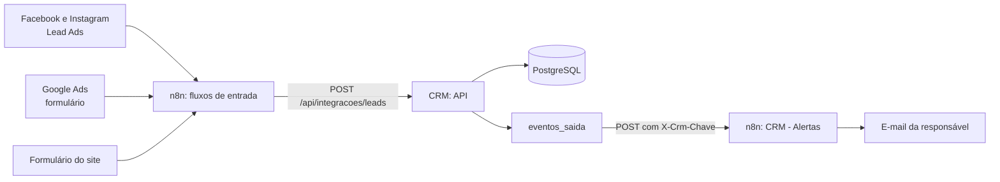

# Especificação: CRM de Leads

Versão 1, de 28/09/2026, baseada no plano de projeto de 24/09/2026.

O CRM recebe os leads que a Gama Marketing gerar nas redes sociais e no Google, distribui entre as atendentes e acompanha cada lead no funil até virar cliente. Um painel mostra os números por campanha. O n8n faz a ponte com Meta, Google, site e e-mail; o CRM guarda os dados e aplica todas as regras.

## 1. Escopo

| Perfil | Quem | Papel |
| --- | --- | --- |
| Admin | Chefe e Matheus (a confirmar) | Vê tudo, distribui leads e configura o sistema |
| Atendente | Adriana e Pietra | Atende os próprios leads |
| Integração | n8n | Envia leads e lê relatórios, só pela API |
| Agência | Gama Marketing | Recebe o relatório por campanha, sem acesso ao sistema |

Ficam fora da primeira versão:

- Conversas de WhatsApp dentro do CRM
- Alerta por WhatsApp e notificação push com o app fechado (o n8n facilita as duas depois)
- Lembretes automáticos de retorno
- Módulo de clientes
- Preenchimento automático dos dados da empresa pelo CNPJ
- Informar à Meta quais leads viraram clientes (o evento `lead.etapa_alterada` já carrega o necessário)

## 2. Perfis e permissões

| Ação | Admin | Atendente | Integração |
| --- | --- | --- | --- |
| Ver leads | Todos | Só os seus | Não |
| Criar lead à mão | Sim, escolhe a responsável ou usa o rodízio | Sim, e o lead fica com ela | Não |
| Editar, mudar etapa, registrar interação | Todos | Só os seus | Não |
| Trocar a responsável | Sim | Não | Não |
| Importar e exportar CSV | Sim | Não | Não |
| Painel | Geral, com filtro por atendente | Só os próprios números | Não |
| Usuários, etapas, motivos de perda, campanhas, distribuição | Sim | Não | Não |
| LGPD (exportar dados do titular, anonimizar) e auditoria | Sim | Não | Não |
| Enviar leads (`POST /api/integracoes/leads`) | Não | Não | Sim |
| Relatório por campanha | Sim, pela tela | Não | Sim (`GET /api/integracoes/relatorios/campanhas`) |

- Lead de outra atendente responde 404, nunca 403, para não revelar que existe.
- Rota de admin chamada por atendente responde 403.
- A chave de integração só vale para `/api/integracoes/*`, e o cookie de usuário não vale nessas rotas.

## 3. Regras de negócio

### 3.1 Dados do lead

| Campo | Regra |
| --- | --- |
| nome | Obrigatório, até 150 caracteres |
| email | Minúsculas, sem espaços, formato validado: antes do @, só ASCII (letras, números e os símbolos do RFC 5322, com pontos só entre eles); o domínio, em rótulos de letras, números e hífen, separados por ponto. Um e-mail com acento, como `joão@exemplo.com`, é inválido |
| telefone | E.164 com libphonenumber, região padrão BR |
| cpf_cnpj | Só letras e números, em maiúsculas. 11 caracteres é CPF; 14 é CNPJ, numérico ou alfanumérico. Dígitos verificadores validados |
| uf | Uma das 27 siglas. A integração e a importação também aceitam o nome do estado, com ou sem acento ("Rio Grande do Sul" vira RS). Valor não reconhecido fica vazio, e o original continua no payload bruto |
| empresa | Opcional, até 150 caracteres |

- Todo lead precisa de nome e de pelo menos um entre e-mail e telefone.
- Na tela, a validação é estrita e mostra o erro no campo. Na edição, o formato de e-mail, telefone e CPF/CNPJ só é conferido nos campos que a pessoa mudou: um valor inválido que veio da integração não impede salvar o resto, e o aviso continua na ficha.
- Na integração e na importação, formato inválido não recusa o lead. O valor é guardado como veio (normalizado quando possível) e a ficha mostra um aviso, calculado na leitura: "E-mail em formato inválido", "Telefone não reconhecido", "CPF/CNPJ inválido" ou "Sem CPF/CNPJ". Valor maior que o tamanho do campo é cortado, também sem recusar o lead.
- CNPJ alfanumérico, válido desde julho de 2026: os 12 primeiros caracteres podem ser letras de A a Z ou números, e os 2 últimos são dígitos. Cada caractere vale o código ASCII menos 48 (0–9 valem 0–9, A vale 17, Z vale 42). Os pesos são 5,4,3,2,9,8,7,6,5,4,3,2 para o primeiro dígito e 6,5,4,3,2,9,8,7,6,5,4,3,2 para o segundo. Se o resto da divisão por 11 for menor que 2, o dígito é 0; senão, é 11 menos o resto. Entrada em minúsculas é convertida antes.
- Valores de teste: `12ABC34501DE35` e `11222333000181` são CNPJs válidos, `52998224725` é CPF válido, e trocar o último dígito de qualquer um deles invalida.

### 3.2 Entrada de leads

Todo lead entra pelo mesmo serviço, `ReceberEntrada`, usado pela integração, pelo cadastro manual e pela importação:

1. **Idempotência:** se já existe entrada processada com a mesma `(origem, id_externo)`, responde com o lead dela e não faz mais nada. A entrada de um lead anonimizado guarda só o hash do id externo (3.8), que também conta.
2. **Registro:** normaliza os dados e grava a entrada em `entradas_recebidas`, com o payload bruto.
3. **Busca:** procura um lead existente e não anonimizado, nesta ordem: CPF/CNPJ, e-mail e telefone normalizados. Cada um só entra na busca quando está em formato válido, para um "a@a" ou um "000" não juntar pessoas diferentes. A busca e a criação rodam sob `pg_advisory_xact_lock`, para duas entradas simultâneas da mesma pessoa não criarem dois leads. As travas usam as chaves da entrada (origem e id externo), da pessoa (documento, e-mail e telefone válidos) e da campanha, pegas em ordem alfabética. Depois de travar a linha do lead achado, a busca confere de novo: se ele foi anonimizado ou excluído enquanto a entrada esperava, ela recomeça sem ele.
4. **Pessoa já existe:** vincula a entrada ao lead e preenche só os campos que estavam vazios. Registra a entrada na linha do tempo, notifica a responsável e gera `lead.entrada_repetida`. Se o lead estava numa etapa do tipo perdido, volta para a etapa inicial (reaberto) e grava `historico_etapas`, sem usuário quando a entrada veio da integração; se estava em ganho, continua em ganho.
5. **Pessoa nova:** cria o lead na etapa inicial, com a origem e a campanha da entrada, distribui (3.3), notifica e gera `lead.criado`.
6. Tudo acontece numa transação só, incluindo o evento em `eventos_saida`.

- Origens possíveis: `meta_lead_ads`, `google_ads`, `site`, `whatsapp`, `telefone`, `indicacao`, `planilha` e `manual`. A integração aceita apenas as três primeiras, e o cadastro manual, `manual`, `telefone`, `whatsapp` e `indicacao`.
- No cadastro manual, se a pessoa já é lead de outra atendente, a entrada é vinculada ao lead dela (passo 4), mas a resposta não traz o id do lead, e a tela só mostra "Já existe um lead com esses dados.", sem dizer de quem. A entrada fica registrada no lead e aparece na linha do tempo dele. A responsável e os admins são avisados pelas notificações do sistema (3.6), e quem cadastrou não recebe aviso.
- A origem e a campanha do lead são as da primeira entrada. Cada entrada guarda as suas.
- **Leads de teste** (`teste = true`) ficam sem responsável e visíveis só para admins. Não geram alerta e ficam fora do painel e dos relatórios. Só esses o admin pode excluir de vez: saem junto as entradas, as interações, o histórico, as notificações e os eventos, e a exclusão entra na auditoria. Sem as entradas, o mesmo lead de teste reenviado entra de novo. Excluir um lead real responde 400, porque os dados de uma pessoa saem pela anonimização (3.8). Uma entrada de teste só é vinculada a um lead de teste, e uma entrada real, a um lead real: o teste da Meta feito com o e-mail de alguém não mexe no lead de verdade dessa pessoa.
- **Campanhas:** a tabela `campanhas` é única por `(origem, id_externo)`. Uma campanha desconhecida é criada com o nome recebido. Sem nome (o Google manda só o id), recebe o nome provisório "{origem} · campanha {id}", como "Google Ads · campanha 123". Um nome que chegue depois só substitui o provisório.
  - O admin renomeia qualquer campanha em Configurações › Campanhas. O nome dado por ele deixa de ser provisório, e um nome que chegue depois pela integração ou pela importação não o substitui.
  - A renomeação usa a mesma trava da entrada (`campanha:{origem}:{id}`), para uma entrada simultânea não sobrescrever o nome do admin, e entra na auditoria (`campanha.renomeada`).
  - Os nomes podem se repetir entre campanhas.

### 3.3 Distribuição

- A configuração `distribuicao_automatica` vem ligada por padrão. O admin a liga e desliga no cartão Rodízio, em Configurações › Usuários, que também mostra para quem vai o próximo lead.
- Ligada, o próximo lead vai para o usuário ativo com `participa_rodizio = true` que recebeu lead há mais tempo: menor `ultimo_lead_atribuido_em`, com nulos primeiro e empate decidido pelo id. A escolha roda sob um `pg_advisory_xact_lock` global, para dois leads simultâneos não caírem na mesma pessoa, e a hora é lida depois da trava, para a vez andar na ordem certa.
- Só o rodízio mexe em `ultimo_lead_atribuido_em`: a escolha do admin no cadastro, a troca de responsável e o lead que a atendente cadastra para si não mudam a vez.
- Se ninguém participa do rodízio ou a distribuição está desligada, o lead fica sem responsável e os admins são notificados, com o motivo.
- Lead criado à mão por atendente fica com ela. Lead criado por admin vai para quem o admin escolher, ou para o rodízio. Os leads da integração vão para o rodízio. Lead de teste não passa pelo rodízio.
- Só admin troca a responsável. A troca notifica a nova responsável, gera `lead.reatribuido` e entra na auditoria. A nova responsável precisa ser um usuário ativo, lead de teste continua sem responsável, e trocar para a mesma pessoa não muda nada.
- Nas férias ou folgas, o admin desmarca `participa_rodizio` da pessoa.

### 3.4 Funil

- Cada etapa tem nome, ordem, tipo (`aberta`, `ganho` ou `perdido`) e situação (ativa ou não).
- Etapas iniciais: Novo, Em contato, Qualificado e Proposta enviada (abertas), Ganho (ganho) e Perdido (perdido).
- A etapa inicial é a etapa aberta ativa de menor ordem.
- Existe sempre exatamente uma etapa ativa do tipo ganho e uma do tipo perdido.
- Etapa com leads não pode ser desativada. A tela oferece mover todos os leads para outra etapa antes: a etapa de destino precisa ser aberta e ativa, e os leads mudam e a etapa é desativada na mesma transação, com uma linha em `historico_etapas` por lead. Essa mudança em lote não conta como primeiro contato. Sem destino, a API responde 409 com a quantidade de leads.
- Etapa nova é sempre do tipo aberta e entra no fim das abertas. Ganho e Perdido podem ser renomeadas, mas não desativadas nem reordenadas: ficam sempre no fim. Os nomes não se repetem, sem diferenciar maiúsculas. A última etapa aberta ativa não pode ser desativada, porque é a etapa inicial.
- Toda mudança de lead trava a etapa de destino (`FOR SHARE`), e a desativação trava a etapa com `FOR UPDATE`: nenhum lead entra numa etapa que está sendo desativada.
- O lead pode ir para qualquer etapa, não só para a seguinte. Ir para a etapa em que ele já está não muda nada nem grava histórico, e uma etapa desativada responde 400.
- **Perdido** exige um motivo da lista configurável, com detalhe opcional (até 500 caracteres). O motivo só é aceito quando o destino é Perdido. Lista inicial: Sem resposta, Sem interesse, Preço, Fechou com concorrente, Fora do perfil e Contato inválido. Um motivo desativado sai da lista de escolha, mas continua nos leads e no histórico, e o último motivo ativo não pode ser desativado.
- **Ganho** grava `convertido_em`. Com `exigir_documento_para_ganho` ligada (padrão), exige CPF/CNPJ válido; sem ele, a API responde 400 com "Para marcar como Ganho, informe um CPF ou CNPJ válido na ficha do lead." O admin muda a configuração em Configurações › Etapas e motivos.
- Ao sair de Ganho ou Perdido, `convertido_em`, `perdido_em` e o motivo são limpos; o histórico guarda tudo.
- Toda mudança grava `historico_etapas` (de, para, quem e quando) e gera `lead.etapa_alterada` (os eventos chegam no Passo 4). As mudanças passam todas pelo serviço `MudancaEtapa`: a da tela, a reabertura por nova entrada e a mudança em lote.

### 3.5 Interações e primeiro contato

- Tipos: `nota`, `ligacao`, `whatsapp`, `email` e `reuniao`. Cada interação tem tipo, descrição e `ocorrido_em`, que vem com a hora atual e aceita datas passadas, nunca futuras.
- A descrição, de até 2.000 caracteres, é obrigatória só na nota: um clique em "Ligar" seguido de "Registrar" já registra a ligação.
- `ocorrido_em` até 5 minutos no futuro (relógio do navegador adiantado) é gravado como a hora atual; mais que isso responde 400. O campo da tela só tem minutos: sem mudar o campo, vale a hora do registro, com os segundos.
- Interações não são editadas nem excluídas: uma correção vira nova nota. A exceção é a anonimização da LGPD.
- `primeiro_contato_em` é gravado uma única vez: na primeira ligação, WhatsApp, e-mail ou reunião registrada, ou na primeira saída da etapa inicial, o que acontecer antes. Vale o `ocorrido_em` da interação, nunca anterior a `criado_em` (um contato de antes da entrada conta como imediato), ou a hora da mudança de etapa. A nota, a reabertura por nova entrada e a mudança em lote ao desativar uma etapa não contam.
- A ficha tem botões de WhatsApp (`https://wa.me/<número sem o +>`), Ligar (`tel:`) e E-mail (`mailto:`). Depois do clique, abre o registro de interação com o tipo já preenchido. Telefone ou e-mail com aviso de formato não vira botão.
- A linha do tempo da ficha junta entradas recebidas, interações, mudanças de etapa e trocas de responsável, da mais recente para a mais antiga, com quem fez (ou "o sistema") e quando. As entradas mostram origem, campanha e situação, sem dados pessoais. As trocas de responsável vêm da auditoria (`lead.reatribuido`, com `detalhes { anteriorId, novoId }`), que o Passo 4 grava.

### 3.6 Notificações

- No sistema, pela tabela `notificacoes` e pelo SignalR:
  - novo lead atribuído a você;
  - lead reatribuído para você;
  - um lead seu recebeu nova entrada;
  - (admin) uma atendente cadastrou à mão uma pessoa que já é lead de outra (3.2);
  - (admin) lead ficou sem responsável;
  - (admin) evento para o n8n falhou de vez;
  - quantos leads novos uma importação deixou com você (3.7);
  - (admin) o resumo da importação que você fez, que abre o resultado dela (3.7).
- Quem fez a ação nunca recebe a notificação dela, e lead de teste não gera notificação. A exceção é o resumo da importação: ela roda em segundo plano, e quem importou pode ter saído da tela. Uma responsável desativada conta como sem responsável, e a nova entrada de um lead sem responsável avisa os admins.
- Cada notificação é de um usuário. O título não leva dados do lead: a lista mostra o nome atual dele, lido na hora, e só se a pessoa ainda vê o lead. A notificação de um lead que passou para outra atendente some da lista dela, e marcá-la responde 404.
- Um sino no topo mostra o contador e a lista, com opção de marcar uma ou todas como lidas. A lista traz as 30 mais recentes, e o contador soma todas as não lidas.
- **Tempo real:** o sino, o quadro, a lista, a ficha, o painel e o relatório por campanha se atualizam pelo hub do SignalR (`/hubs/notificacoes`), sem consultar a API de tempos em tempos. O hub só manda ids, e a tela busca os dados na API, que aplica a visibilidade de sempre:
  - `LeadsAlterados(ids)`: os admins recebem os ids de todos os leads; a responsável, só os dos leads que são dela na hora do envio (lead de teste, só os admins). Quem perde um lead numa troca de responsável recebe o aviso sem ids, que recarrega o que estiver aberto: o id de um lead que já é de outra pessoa não chega até ela;
  - `NotificacaoNova(id)`: só para o dono da notificação;
  - `FunilAlterado()`: para todos, quando as etapas ou os motivos de perda mudam.
- Os avisos saem depois do commit, e uma mudança desfeita não avisa. A tela recarrega no máximo uma vez por segundo; ao reconectar, recarrega tudo, porque os avisos do tempo sem conexão se perderam. Durante o arraste, o quadro espera a pessoa soltar. Na ficha, uma mudança de outra pessoa nos dados não apaga o que alguém está digitando: aparece o aviso "Outra pessoa alterou os dados deste lead", e salvar responde o conflito (409).
- Com a aba em segundo plano e a permissão dada, o navegador mostra uma notificação nativa, só com o título, que nunca leva dados do lead; o clique abre a ficha e marca como lida. A permissão é pedida uma vez, depois do login, num aviso com "Ativar" e "Agora não". Enquanto a pessoa não decide, o sino oferece ativá-la.
  - No build de produção, a notificação sai pelo service worker do PWA (Passo 11), que também a leva ao celular. Sem ele, ela sai pelo `new Notification`, só no computador: o Chrome do Android só a mostra pelo service worker, e o Safari do iPhone, só no app instalado. Fica sem service worker o desenvolvimento e o Compose de produção no próprio computador (`https://localhost`), cujo certificado local o Chrome recusa para o service worker.
  - Ela chega enquanto o CRM está aberto, mesmo em segundo plano: com ele fechado, não há conexão do tempo real, e o push com o app fechado está fora da primeira versão (seção 1).
  - Pelo service worker, o clique traz a janela do CRM para a frente, que abre a ficha e marca como lida. Com o CRM fechado, ele abre a ficha numa janela nova e marca a notificação como lida. Nos dados da notificação vão só o id dela e o endereço da ficha.
- Os e-mails de alerta saem do n8n, a partir dos eventos (seção 4).

### 3.7 Importação e exportação

- **Importação (admin):** arquivo CSV de até 5 MB, 5.000 linhas e 100 colunas. O sistema detecta a codificação (UTF-8, UTF-16 ou Windows-1252) e o separador (vírgula, ponto e vírgula ou tab, ou o da linha `sep=;` do Excel). A primeira linha é o cabeçalho. Linhas vazias são ignoradas, e uma planilha `.xlsx` é recusada com a instrução de salvá-la como CSV.
- O fluxo da tela é:
  1. enviar o arquivo;
  2. ver a prévia das 10 primeiras linhas;
  3. mapear as colunas, com sugestão pelo cabeçalho (nome/full_name, email/e-mail, telefone/phone_number/celular e assim por diante);
  4. escolher a origem, a campanha padrão, a coluna de id externo (opcional) e a distribuição (rodízio ou uma pessoa);
  5. processar.
- **Mapeamento:** cada coluna vai para um dado do lead (nome, e-mail, telefone, CPF/CNPJ, UF ou empresa), para a campanha, o conjunto, o anúncio ou o formulário (id ou nome), para a plataforma, as UTMs e o gclid, para as respostas extras ou para nenhum lugar. O nome aceita mais de uma coluna (nome e sobrenome, juntados nessa ordem); os outros campos, uma só. A sugestão manda as colunas desconhecidas para as respostas extras e deixa de fora as colunas técnicas da exportação da Meta (`created_time`, `is_organic`, `lead_status`, `inbox_url`). O payload bruto guarda a linha inteira, com o número dela.
- **Origem:** qualquer uma, menos `manual`. O padrão é `planilha`, e a análise sugere `meta_lead_ads` quando o cabeçalho é o da exportação da Meta.
- **Id externo:** o da coluna escolhida, sugerida quando é `lead_id` ou um `id` com os ids de lead da Meta (`l:123`). Sem a coluna, ou com a célula vazia, o id externo é `sha256:` com o hash do conteúdo da linha (as colunas preenchidas, com o nome de cada uma, em ordem alfabética). Assim, reimportar o mesmo arquivo responde "já importado", mesmo numa planilha sem id.
- **Arquivo da Meta:** os prefixos que a exportação põe nos ids e no telefone (`l:`, `c:`, `as:`, `ag:`, `f:` e `p:`) saem, e a plataforma `fb` ou `ig` vira `facebook` ou `instagram`. Os ids e as campanhas batem com os que a integração manda.
- **Campanha:** vale a da linha; só com o nome, o nome serve de id. A campanha padrão vale para as linhas sem campanha: uma que já existe, da mesma origem, ou uma nova, pelo nome, criada na primeira linha que a usa.
- **Linha com erro:** só a falta de nome, a falta de e-mail e telefone, um id externo com mais de 100 caracteres e um problema de estrutura (valor numa coluna a mais, aspas sem fechamento) recusam a linha. Formato inválido entra com o aviso na ficha, como na integração (3.1). O número da linha é o da planilha, contando o cabeçalho como linha 1.
- Cada linha passa pelo `ReceberEntrada`, com o admin que importou como autor. Por padrão, a importação não notifica nem gera evento por lead: nada de `lead.criado` nem de `lead.entrada_repetida`. O `lead.etapa_alterada` da reabertura de um lead perdido segue a 4.3. No fim, o admin recebe um resumo e cada responsável recebe uma notificação com quantos leads ganhou.
- **Distribuição:** pelo rodízio, que passa a vez a cada lead novo, ou para uma pessoa ativa, o que não mexe na vez (3.3).
- **Processamento em segundo plano:** a importação é gravada e processada linha a linha, e a tela acompanha o andamento. Se a API parar no meio, a importação continua de onde parou, e as linhas que já tinham entrado respondem "já importado" sem mudar as contagens. O arquivo fica guardado só até o fim do processamento.
- O resultado mostra quantos leads foram criados, vinculados a leads existentes, já importados antes e com erro (com linha e motivo), e quantos dos criados ficaram sem responsável. O relatório de erros pode ser baixado: um CSV para o Excel (UTF-8 com BOM e ponto e vírgula) com a linha e o motivo, sem dados pessoais.
- A importação entra na auditoria (`importacao.criada`, com a origem e o número de linhas, sem o nome do arquivo), e cada lead criado, como `lead.criado` do admin que importou.
- **Exportação (admin):** CSV dos leads com os filtros e a ordem da lista, sem paginação, no formato do Excel da seção 8 (UTF-8 com BOM, ponto e vírgula, CRLF e o apóstrofo contra fórmula), com o nome `leads-2026-10-09.csv`:
  - as colunas são Id, Nome, E-mail, Telefone, CPF/CNPJ, UF, Empresa, Etapa, Motivo da perda, Responsável, Origem, Plataforma, Campanha, as cinco UTMs, GCLID, Respostas do formulário (`Pergunta: resposta | …`), Entrada, Primeiro contato, Ganho em, Perdido em, Teste (Sim ou Não) e Anonimizado em;
  - o telefone do Brasil sai no formato nacional, `(51) 99999-8888`; o de outro país, no internacional; e o não reconhecido, como foi guardado;
  - o CPF e o CNPJ saem com a máscara, como `529.982.247-25` e `12.ABC.345/01DE-35`, porque sem ela o Excel tira os zeros do começo e mostra o CNPJ em notação científica;
  - as datas saem no horário de Brasília, como `05/10/2026 14:03`.

  Cada exportação entra na auditoria (`leads.exportados`), com o número de linhas e os filtros. Da busca, a auditoria guarda só que houve uma, porque o texto pode ser um nome ou um e-mail.
- **Relatório por campanha:** CSV sem dados pessoais (seção 8).

### 3.8 LGPD

- São dados pessoais: nome, e-mail, telefone, CPF/CNPJ, empresa quando identifica a pessoa, respostas extras, payload bruto das entradas e os textos livres sobre a pessoa, que são a descrição das interações e o detalhe do motivo de perda. O gclid e o id externo das entradas também levam até a pessoa, no Google e na Meta.
- O admin pode exportar todos os dados de um lead em JSON, num arquivo `dados-titular-lead-{id}.json`, com:
  - os dados do lead, com a etapa, a responsável, a campanha e o motivo de perda pelo nome;
  - as entradas, com o payload bruto;
  - as interações e o histórico de etapas;
  - os avisos enviados ao n8n, só com o tipo, a situação e as datas, sem o payload.

  A exportação entra na auditoria.
- O admin também pode anonimizar o lead. Anonimizar faz o seguinte, numa transação só:
  - troca o nome por "Titular removido";
  - no lead, apaga e-mail, telefone, CPF/CNPJ, empresa, respostas extras, gclid e o detalhe do motivo de perda;
  - nas entradas, apaga o payload bruto, as respostas extras e o gclid;
  - apaga as descrições das interações e o detalhe do motivo de perda no histórico;
  - troca o id externo de cada entrada por `anon:` e o SHA-256 dele, em hexadecimal. O banco deixa de guardar o id da Meta ou do Google, e um reenvio do n8n ou a reimportação do mesmo arquivo continua respondendo "já recebido" ou "já importado" (3.2), sem trazer a pessoa de volta. É um hash sem chave: quem tiver uma cópia do banco consegue descobrir um id numérico da Meta testando todos. Um HMAC com chave impediria isso, mas a chave nunca poderia mudar nem se perder;
  - apaga os eventos do lead em `eventos_saida`, inclusive os pendentes, porque o payload leva o nome e a empresa;
  - mantém etapa, motivo de perda, datas, origem, plataforma, campanha, conjunto, anúncio, formulário, UTMs, UF e responsável, para as métricas continuarem certas;
  - grava `anonimizado_em` e o registro na auditoria, com quantas entradas e interações foram limpas e quantos eventos foram apagados.
- As notificações ficam como estão: o título nunca leva dados do lead (3.6), e a lista mostra o nome atual, "Titular removido".
- Com uma importação processando, anonimizar responde 409 e pede para tentar de novo quando ela terminar: o arquivo da importação, que tem os dados das pessoas, só é apagado no fim (3.7).
- O lead anonimizado não aceita edição dos dados nem interações novas (400), para os dados pessoais não voltarem. A etapa e a responsável continuam mudando, para o admin fechar um lead que estava em andamento. Ir para Perdido leva só o motivo: o detalhe é texto livre e poderia trazer um dado pessoal de volta, então um detalhe preenchido responde 400, e o pedido do motivo, na ficha e no quadro, não oferece o campo. Anonimizar de novo não muda nada.
- Uma entrada nova da mesma pessoa, com outro id externo, cria um lead novo, porque a busca ignora os anonimizados (3.2).
- A anonimização é irreversível e pede confirmação.
- A auditoria registra:
  - login, com sucesso ou falha;
  - criação e edição de lead, só com os nomes dos campos alterados, sem os valores;
  - troca de responsável;
  - exportações e anonimizações;
  - exclusão de lead de teste;
  - mudanças em usuários e configurações.
- No n8n, os fluxos `CRM - ` ficam com "salvar execuções de produção com sucesso" desligado, para não guardar dados pessoais sem necessidade. Os JSONs de `n8n/` já levam o ajuste (`saveDataSuccessExecution: none`), e um teste confere cada fluxo guardado. No n8n de produção, falta conferir o ajuste depois de importar os fluxos e ver por quanto tempo ficam as execuções com erro, que guardam o payload e o que o gatilho recebeu (4.5): no n8n Cloud, é o prazo do plano; no Community, `EXECUTIONS_DATA_PRUNE` e `EXECUTIONS_DATA_MAX_AGE`.

## 4. Integração com o n8n

### 4.1 Quem faz o quê



O n8n recebe dos canais externos e entrega ao CRM já no formato da seção 4.2. Os eventos do CRM voltam para o n8n, que manda os alertas.

| Fica no CRM | Fica no n8n |
| --- | --- |
| Dados, regras, permissões, funil e métricas | Receber leads da Meta, do Google e do site |
| Deduplicação, rodízio e notificações no sistema | Mandar e-mails (e, depois, WhatsApp) a partir dos eventos |
| Fila de eventos com reenvio | Guardar os leads quando o CRM estiver fora do ar e reenviar depois |
| Relatórios com dados agregados | Enviar o relatório para a Gama |

O formulário do site passa pelo n8n porque o navegador não pode guardar a chave do CRM. O n8n recebe o envio público e acrescenta a chave.

### 4.2 Entrada: `POST /api/integracoes/leads`

- Autenticação pelo cabeçalho `X-Api-Key`, comparado em tempo constante (`CryptographicOperations.FixedTimeEquals`).
- Limite de 120 requisições por minuto.

```json
{
  "origem": "meta_lead_ads",
  "idExterno": "1234567890123456",
  "recebidoEm": "2026-10-05T14:03:00Z",
  "teste": false,
  "nome": "Maria Souza",
  "email": "maria@empresax.com.br",
  "telefone": "+5551999998888",
  "cpfCnpj": null,
  "uf": "RS",
  "empresa": "Empresa X",
  "plataforma": "instagram",
  "campanha": { "id": "120210000000001", "nome": "Outubro | Serviço Y" },
  "conjunto": { "id": "120210000000002", "nome": "RS | 25-55" },
  "anuncio": { "id": "120210000000003", "nome": "Vídeo 1" },
  "formulario": { "id": "987654321", "nome": "Orçamento" },
  "utm": { "source": "instagram", "medium": "paid", "campaign": "outubro-servico-y", "content": null, "term": null },
  "gclid": null,
  "respostasExtras": { "Qual serviço você procura?": "Serviço Y" }
}
```

| Campo | Obrigatório | Observação |
| --- | --- | --- |
| origem | Sim | `meta_lead_ads`, `google_ads` ou `site` |
| idExterno | Sim | Id do lead na Meta ou no Google (`lead_id`). No site, o n8n gera um UUID por envio |
| recebidoEm | Sim | ISO 8601 |
| teste | Não | Padrão `false` |
| nome | Sim | |
| email, telefone | Pelo menos um | |
| cpfCnpj, uf, empresa | Não | |
| plataforma | Não | `facebook`, `instagram`, `google` ou `site` |
| campanha, conjunto, anuncio, formulario | Não | Objetos `{ id, nome }`. O Google manda só o id da campanha. `conjunto` é o conjunto de anúncios da Meta ou o grupo de anúncios do Google |
| utm, gclid | Não | |
| respostasExtras | Não | Objeto com pergunta e resposta |

| Resposta | Corpo | O que o n8n faz |
| --- | --- | --- |
| 201 | `{ "leadId": 1024, "situacao": "criado" }` | Segue |
| 200 | `{ "leadId": 1024, "situacao": "vinculado" }`, quando a pessoa já existia | Segue |
| 200 | `{ "leadId": 1024, "situacao": "ja_recebido" }`, quando a mesma origem e o mesmo idExterno já foram processados | Segue |
| 400 | ProblemDetails com os erros | Não reenvia e avisa o admin |
| 401 | Vazio | Não reenvia e avisa o admin |
| 429, 5xx ou tempo esgotado | Vazio | Tenta de novo e, se não der, guarda na fila de pendentes |

A resposta 400 vale só para problemas de estrutura: falta de nome, falta de e-mail e telefone ao mesmo tempo, origem inválida ou falta de idExterno. Formatos inválidos são aceitos com aviso (3.1).

### 4.3 Saída: eventos do CRM para o n8n

- Tipos: `lead.criado`, `lead.entrada_repetida`, `lead.reatribuido` e `lead.etapa_alterada`.
- Só são gravados em `eventos_saida` os tipos listados em `N8n__Eventos`, porque cada envio consome uma execução do plano do n8n. Padrão: `lead.criado,lead.reatribuido,lead.entrada_repetida`. Um tipo desconhecido na lista impede a API de subir.
- Lead de teste não gera evento. `lead.criado`, `lead.entrada_repetida` e `lead.reatribuido` também não são gravados quando quem fez a ação é a própria responsável do lead, que já sabe dela. `lead.etapa_alterada`, quando está na lista, é gravado em toda mudança.
- A entrega é um `POST` para `N8n__WebhookUrl` com os cabeçalhos `X-Crm-Chave` (valor de `N8n__WebhookChave`, conferido pelo Webhook do n8n com Header Auth), `X-Crm-Evento-Id` e `Content-Type: application/json`. O tempo limite é de 10 segundos (`N8n__TempoLimiteSegundos`), e qualquer resposta 2xx conta como entregue.
- O despachante roda em segundo plano e confere a fila a cada 5 segundos (`N8n__IntervaloSegundos`). Cada evento vencido é reservado por 1 minuto, para outro despachante não pegá-lo, e enviado fora da transação.
- Em caso de falha, o despachante tenta de novo depois de 1 min, 5 min, 30 min, 2 h, 6 h e 12 h. Depois disso o evento fica como `falhou` e os admins são notificados, com o tipo do evento e o último erro. `ultimo_erro` guarda só o código HTTP ou o tipo da falha (`HTTP 503`, `Tempo esgotado (10 s)`, `Falha de conexão (ConnectionError)`), nunca o corpo da resposta.
- A entrega é "pelo menos uma vez", sem garantia de ordem.
- A anonimização do lead apaga os eventos dele, inclusive os pendentes (3.8). Um evento apagado durante o envio é deixado de lado, sem aviso de falha.
- Sem `N8n__WebhookUrl` configurada, o despachante não envia nada e os eventos ficam pendentes.
- O evento não leva e-mail, telefone nem CPF/CNPJ do lead. Quem precisa desses dados abre a ficha pelo link.
- O evento é montado na hora da mudança. `lead.origem`, `lead.campanha` e `lead.idExterno` são os da primeira entrada, e o link usa `Crm__UrlPublica`. `responsavel` vem `null` quando o lead está sem responsável ou a responsável está desativada, e aí o n8n avisa o e-mail de admin.

```json
{
  "id": "0f8b1c3e-2d4a-4b7e-9f1a-6c5d8e7f9a0b",
  "tipo": "lead.criado",
  "ocorridoEm": "2026-10-05T14:03:12Z",
  "lead": {
    "id": 1024,
    "nome": "Maria Souza",
    "empresa": "Empresa X",
    "uf": "RS",
    "origem": "meta_lead_ads",
    "plataforma": "instagram",
    "campanha": "Outubro | Serviço Y",
    "idExterno": "1234567890123456",
    "etapa": { "id": 1, "nome": "Novo", "tipo": "aberta" },
    "url": "https://crm.exemplo.com.br/leads/1024"
  },
  "responsavel": { "id": "5b1e…", "nome": "Adriana", "email": "adriana@empresa.com.br" },
  "dados": {}
}
```

O campo `dados` muda conforme o tipo:

| Tipo | `dados` |
| --- | --- |
| `lead.criado` | Vazio. `responsavel` vem `null` quando o lead fica sem responsável |
| `lead.entrada_repetida` | `{ "origem", "campanha" }` da nova entrada |
| `lead.reatribuido` | `{ "responsavelAnterior": { "id", "nome" } }` |
| `lead.etapa_alterada` | `{ "etapaAnterior": { "id", "nome", "tipo" }, "motivoPerda": "..." }` |

### 4.4 Relatório: `GET /api/integracoes/relatorios/campanhas?de=2026-10-01&ate=2026-10-31`

Usa a mesma chave e o mesmo limite de requisições da entrada. Devolve o relatório por campanha da seção 8, o mesmo da tela do admin: uma linha por campanha, com origem, campanha, leads novos, entradas, em andamento, ganhos, perdidos, taxa de conversão e mediana do primeiro contato em minutos, e o total. Não leva dados pessoais.

- **Sem `de` e `ate`:** a semana anterior inteira, de segunda a domingo no horário de Brasília, que é o que o fluxo semanal pede, sem calcular data. Numa segunda ou numa quarta, como em 05/10/2026 ou 07/10/2026, a semana é a de 28/09 a 04/10. Num domingo, a semana que termina nele ainda não acabou e não conta.
- **Com as datas, ou só com uma delas:** valem as regras do período da seção 8, e um período inválido responde 400.

```json
{
  "de": "2026-10-01",
  "ate": "2026-10-31",
  "linhas": [
    {
      "origem": "meta_lead_ads",
      "campanha": { "id": 7, "nome": "Outubro | Serviço Y" },
      "leadsNovos": 36,
      "entradas": 39,
      "emAndamento": 21,
      "ganhos": 9,
      "perdidos": 6,
      "taxaConversao": 0.25,
      "medianaPrimeiroContatoMinutos": 18.5
    },
    {
      "origem": "site",
      "campanha": null,
      "leadsNovos": 4,
      "entradas": 4,
      "emAndamento": 3,
      "ganhos": 1,
      "perdidos": 0,
      "taxaConversao": 0.25,
      "medianaPrimeiroContatoMinutos": 32
    }
  ],
  "total": { "leadsNovos": 40, "entradas": 43, "emAndamento": 24, "ganhos": 10, "perdidos": 6, "taxaConversao": 0.25, "medianaPrimeiroContatoMinutos": 20 }
}
```

`GET /api/integracoes/relatorios/campanhas/csv`, com os mesmos parâmetros, devolve o relatório no CSV da seção 8: o mesmo arquivo que o admin baixa na tela.

### 4.5 Fluxos do n8n

| Fluxo | Gatilho | O que faz | Passo |
| --- | --- | --- | --- |
| `CRM - Alertas` | Webhook `POST` com Header Auth | Recebe os eventos e manda e-mail para a responsável com nome, empresa, origem, campanha e o link da ficha. Sem responsável, avisa o e-mail de admin do nó "Configuração" | 4 |
| `CRM - Erros` | Error Trigger | Manda e-mail para o admin com o nome do fluxo, o nó e o link da execução, sem a mensagem do erro, que pode trazer dado pessoal. É o fluxo de erro de todos os fluxos `CRM - ` | 4 |
| `CRM - Entrada Meta` | Facebook Lead Ads Trigger | Busca na Graph API a campanha e a plataforma do lead, que o gatilho não traz, monta o JSON da seção 4.2 (`idExterno` é o id do lead na Meta) com campanha, conjunto, anúncio, formulário e plataforma, e envia ao CRM | 6 |
| `CRM - Entrada Google` | Webhook `POST` | Confere o SHA-256 do `google_key` (errado: responde 403 e avisa o admin), responde 200 com `{}` e mapeia `user_column_data` pelo `column_id` (FULL_NAME, ou FIRST_NAME e LAST_NAME, EMAIL ou WORK_EMAIL, PHONE_NUMBER ou WORK_PHONE, COMPANY_NAME, REGION; as outras colunas vão para as respostas extras, pelo nome da pergunta). Usa `lead_id` como idExterno, `campaign_id`, `adgroup_id`, `creative_id` e `form_id` como campanha, conjunto, anúncio e formulário, como texto, `gcl_id` como gclid e `is_test` como teste | 6 |
| `CRM - Entrada Site` | Webhook `POST`, com CORS liberado só para o domínio do site | Descarta envios com o campo isca `website` preenchido (responde do mesmo jeito), gera o idExterno (UUID), responde `{ "recebido": true }` e envia ao CRM, com as UTMs. O lead do site nunca é de teste | 6 |
| `CRM - Reenvio de pendentes` | Schedule de hora em hora, das 8h às 20h, de segunda a sexta | Reenvia o que está na Data Table `crm_entradas_pendentes`, um por segundo e uma tentativa por linha. Apaga a linha quando dá certo (inclusive `ja_recebido`); quando falha, soma a tentativa e grava o erro | 6 |
| `CRM - Relatório semanal Gama` | Schedule toda segunda às 8h | Busca o resumo e o CSV do relatório sem datas, que vêm com a semana anterior (4.4), e manda o CSV para a Gama por e-mail, anexo, com o período e o total no texto | 9 |

- **Configuração e segredos:**
  - Cada fluxo começa por um nó Set chamado "Configuração", com os endereços e os e-mails: o endereço do CRM, o e-mail do admin, o remetente e o e-mail da Gama. Os segredos ficam só em credenciais.
  - Os fluxos usam só o que o n8n Cloud também tem: nada de `$env`, `$vars`, Execute Command ou arquivos em disco.
  - Há duas exceções, por limite do n8n. O domínio do site fica no "Allowed Origins (CORS)" do Webhook, que o n8n lê antes de o fluxo rodar. A chave do Google entra no "Configuração" só como SHA-256 (`googleKeySha256`), porque uma credencial não chega às expressões.
  - A chave do Google é aleatória, com 64 caracteres, para o hash, que vai para o Git, não poder ser revertido.
- **E-mail:** os fluxos mandam pelo nó Send Email, com uma credencial SMTP, em texto simples. Em desenvolvimento, é uma conta do Gmail só para os testes, com senha de app; em produção, o e-mail da empresa. O remetente precisa ser outra conta, e não a que recebe: um e-mail de uma conta do Gmail para um alias dela mesma chega como enviado, sem notificar o celular.
- **Alertas:** o Webhook (`/webhook/crm-alertas`) confere o `X-Crm-Chave` por uma credencial Header Auth e só responde ao CRM depois de mandar o e-mail: se o envio falhar, o n8n responde com erro e o CRM tenta de novo. O e-mail vai em texto simples, para nenhum dado do lead virar HTML. Só `lead.criado`, `lead.entrada_repetida` e `lead.reatribuido` geram e-mail; os outros tipos recebem 200 sem e-mail.
- **Chave do CRM:** fica na credencial Header Auth `CRM - Chave de integração` (`X-Api-Key`), usada pelos HTTP Request. Um HTTP Request com credencial nunca baixa a resposta como arquivo: nesse modo, o n8n guarda nos dados da execução a requisição inteira, com o cabeçalho da credencial.
- **Relatório semanal:** o HTTP Request chama `GET /api/integracoes/relatorios/campanhas` e o `/csv` sem datas, e o CRM devolve a semana anterior inteira: o fluxo não calcula data. O CSV chega como texto e vai anexo em UTF-8 com BOM, o mesmo arquivo que o admin baixa na tela, para o endereço da Gama do nó "Configuração". Se a Gama preferir uma planilha, o fluxo usa só o JSON.
- **Falhas no envio ao CRM:**
  - O HTTP Request tenta 3 vezes, a cada 5 segundos, com tempo limite de 10 s.
  - Se ainda falhar com 429, 5xx, tempo esgotado ou falha de conexão, o payload vai para `crm_entradas_pendentes` (colunas: payload, tentativas, ultimo_erro, criado_em), que os fluxos acham pelo nome. O site e o Google já receberam a resposta antes.
  - Um 4xx que não é 408 nem 429, como o 400 e o 401, não vai para a fila: o fluxo termina com erro e dispara o `CRM - Erros`.
  - O `ultimo_erro` guarda só o código ou o tipo da falha (`HTTP 503`, `Tempo esgotado (10 s)`, `Falha de conexão`), nunca o corpo da resposta.
- **Site:** o formulário manda, em JSON ou como formulário, `nome`, `email`, `telefone`, `empresa`, `uf`, `mensagem`, as UTMs (`utm_source`, `utm_medium`, `utm_campaign`, `utm_content` e `utm_term`), o `gclid` e o campo isca `website`, escondido e vazio. A mensagem e qualquer outro campo preenchido vão para as respostas extras. Como o site recebe `{ "recebido": true }` antes do envio ao CRM, o formulário confere o nome e o e-mail ou o telefone: um envio sem eles responde 400 no CRM e avisa o admin.
- **Meta:**
  - O gatilho de Lead Ads do n8n traz o lead, o anúncio, o conjunto e o formulário, mas não a campanha nem a plataforma. O fluxo as busca no lead (`campaign_id`, `campaign_name` e `platform`) pela Graph API, com a mesma credencial. Se a consulta falhar, o lead entra sem elas, e o fluxo termina com erro, avisando o admin.
  - Os campos seguem os que a importação reconhece no CSV da Meta. `fb` e `ig` viram `facebook` e `instagram`, a data `+0000` vira ISO 8601, e os valores `<test lead: …>` da Ferramenta de Teste marcam o lead como teste.
  - O gatilho escuta um formulário: para vários formulários, o fluxo leva um gatilho por formulário.
  - O app da Meta usado pela credencial do n8n precisa estar em modo Live, o que exige a URL da política de privacidade. Também precisa de acesso avançado a `public_profile` e da verificação da empresa concluída.
  - Quem autoriza a credencial precisa ser admin da página.
  - A Meta aceita um único webhook por app, então alternar entre a URL de teste e a de produção do n8n desliga a outra. Teste direto na URL de produção, com a Ferramenta de Teste de Anúncios de Cadastro. Os leads dessa ferramenta devem chegar com `teste: true`.
  - Se o acesso a leads for restrito nas configurações do negócio (Integrações > Acesso a leads), libere o app lá.
- **Google:** a Gama cola a URL do webhook e a chave no formulário de lead do Google Ads. O botão "Enviar dados de teste" manda `is_test: true`.
- **Orçamento de execuções:** com 300 leads por mês, o consumo fica perto de 900 execuções: cerca de 300 de entrada, 300 de alerta, 290 de reenvio e 4 de relatório. Isso cabe no plano Starter, que tem 2.500 por mês.
- **Execuções com erro:** ficam salvas com o que o gatilho recebeu: o payload do lead, o `google_key` do Google e o `X-Crm-Chave` do Alertas (3.8).
- **Instâncias:**
  - Desenvolvimento: desde 14/10/2026, um n8n Community (2.43.5) no Compose de desenvolvimento, com os 7 fluxos testados com dados de teste (README › n8n local). A instância de teste `matheusbordinhao.app.n8n.cloud` acabou em 06/10/2026.
  - Produção: o n8n Cloud, numa conta da empresa, quando o pagamento sair (seção 11).
  - Os JSONs em `n8n/` levam os fluxos de uma instância para outra. No destino, são refeitos as credenciais, a Data Table, os valores do nó "Configuração" e o fluxo de erro (README › n8n Cloud: importar os fluxos).

## 5. Modelo de dados

Nomes em snake_case. O banco usa a extensão `unaccent` para a busca sem acento.

| Tabela | Colunas principais | Observações |
| --- | --- | --- |
| usuarios (Identity) | Campos do Identity, mais nome, ativo, participa_rodizio, ultimo_lead_atribuido_em, trocar_senha, criado_em | Id uuid. Admin e Atendente são roles, na tabela `perfis`. As outras tabelas do Identity também têm nomes em português (`usuarios_perfis`, `usuarios_claims`, `usuarios_logins`, `usuarios_tokens`, `perfis_claims`) |
| etapas | id, nome, ordem, tipo, ativa | Tipo: `aberta`, `ganho` ou `perdido` |
| motivos_perda | id, nome, ativo | |
| campanhas | id, origem, id_externo, nome, nome_provisorio | Única por (origem, id_externo) |
| leads | id (bigint), nome, email, telefone, cpf_cnpj, uf, empresa, etapa_id, responsavel_id, origem, plataforma, campanha_id, utm_source, utm_medium, utm_campaign, utm_content, utm_term, gclid, respostas_extras (jsonb), motivo_perda_id, motivo_perda_detalhe, teste, criado_em, atualizado_em, primeiro_contato_em, convertido_em, perdido_em, anonimizado_em | Índices em email, telefone, cpf_cnpj, (responsavel_id, etapa_id), campanha_id e criado_em. Concorrência otimista pelo `xmin` |
| entradas_recebidas | id, lead_id, origem, id_externo, campanha_id, conjunto, anuncio e formulario (jsonb, com id e nome), utm_*, gclid, respostas_extras, payload_bruto (jsonb), situacao, erro, teste, recebido_em, processado_em, importacao_id | Situação: `criado`, `vinculado` ou `erro`. Índice único parcial em (origem, id_externo) onde a situação não é `erro`. `importacao_id` liga a entrada à importação que a trouxe. Na anonimização, o `id_externo` vira `anon:` e o SHA-256 dele (3.8) |
| importacoes | id, usuario_id, nome_arquivo, codificacao, separador, origem, campos (text[]), coluna_id_externo, campanha_padrao_id, campanha_padrao_nome, responsavel_id, arquivo (bytea), situacao, total_linhas, linhas_processadas, criados, vinculados, ja_importados, com_erro, sem_responsavel, reservada_ate, criado_em, concluido_em | Situação: `processando` ou `concluida`. O arquivo é apagado no fim. A reserva é renovada a cada linha; vencida com a importação ainda processando, outra rodada a retoma. `responsavel_id` nulo é o rodízio |
| importacoes_erros | id, importacao_id, linha, motivo | Sem dados pessoais: a linha é a da planilha |
| historico_etapas | id, lead_id, etapa_anterior_id, etapa_nova_id, motivo_perda_id, motivo_perda_detalhe, usuario_id, ocorrido_em | O motivo continua aqui depois de o lead sair de Perdido. usuario_id fica nulo quando quem mudou foi o sistema, como na reabertura de um lead perdido por uma nova entrada |
| interacoes | id, lead_id, usuario_id, tipo, descricao, ocorrido_em, criado_em | |
| notificacoes | id, usuario_id, tipo, titulo, lead_id, importacao_id, lida_em, criado_em | `importacao_id` só no resumo da importação, para quem importou |
| eventos_saida | id (uuid), tipo, lead_id, payload (jsonb), situacao, tentativas, proxima_tentativa_em, entregue_em, ultimo_erro, criado_em | Situação: `pendente`, `entregue` ou `falhou`. Índice em (situacao, proxima_tentativa_em). O `lead_id` liga o evento ao lead, para o aviso de falha e para a LGPD: a anonimização apaga os eventos do lead. O payload leva nome e empresa do lead, e `ultimo_erro` só o código HTTP ou o tipo da falha |
| auditoria | id, usuario_id, acao, entidade, entidade_id, detalhes (jsonb, sem dados pessoais), ip, ocorrido_em | As trocas de responsável da linha do tempo vêm daqui. No login com e-mail desconhecido, usuario_id fica nulo e o e-mail digitado não é gravado. O ip de um cliente IPv4 é gravado sem o prefixo `::ffff:`, mesmo quando a conexão chega por um socket IPv6, e conta assim também no limite de logins |
| configuracoes | chave, valor | `distribuicao_automatica`, `exigir_documento_para_ganho` |

## 6. API

Os erros seguem o padrão ProblemDetails, com mensagens em português. Campo ausente no corpo JSON responde 400 em vez de assumir o valor padrão: um `perfil` ou um `ativo` omitido não vira Admin nem desativa ninguém. A documentação OpenAPI fica disponível em desenvolvimento.

| Método e rota | Quem | O que faz |
| --- | --- | --- |
| `POST /api/auth/login`, `POST /api/auth/logout`, `GET /api/auth/eu`, `POST /api/auth/trocar-senha` | Todos | Acesso |
| `GET /api/leads` | Admin e atendente | Lista com busca, filtros (etapa, responsável, origem, campanha, período) e paginação |
| `GET /api/leads/{id}` | Admin e atendente | Ficha, com os avisos da seção 3.1 |
| `POST /api/leads`, `PUT /api/leads/{id}` | Admin e atendente | Criar e editar |
| `POST /api/leads/{id}/etapa` | Admin e atendente | Mudar etapa, com motivo quando for Perdido |
| `POST /api/leads/{id}/responsavel` | Admin | Trocar responsável (`{ responsavelId }`) |
| `GET /api/leads/{id}/linha-do-tempo`, `POST /api/leads/{id}/interacoes` | Admin e atendente | Linha do tempo e interações |
| `POST /api/importacoes/analise` | Admin | Lê o arquivo (em base64, no JSON) e devolve a codificação, o separador, a prévia de 10 linhas e a sugestão de mapeamento, sem gravar nada |
| `POST /api/importacoes`, `GET /api/importacoes/{id}`, `GET /api/importacoes/{id}/erros` | Admin | Importação CSV: cria (202, processada em segundo plano), andamento e resultado, e relatório de erros em CSV |
| `GET /api/leads/exportacao` | Admin | CSV com os filtros e a ordem da lista, sem paginação (3.7) |
| `GET /api/leads/{id}/dados-titular`, `POST /api/leads/{id}/anonimizar` | Admin | LGPD (3.8): o JSON do titular, para baixar, e a anonimização, que devolve a ficha e responde 409 com uma importação processando |
| `DELETE /api/leads/{id}` | Admin | Só para leads de teste |
| `GET /api/usuarios`, `GET /api/usuarios/{id}`, `POST /api/usuarios`, `PUT /api/usuarios/{id}`, `POST /api/usuarios/{id}/redefinir-senha` | Admin | Criar, editar, desativar (`ativo = false`) e redefinir a senha provisória, o que também tira o bloqueio. O admin não pode desativar a si mesmo nem tirar o próprio perfil de Admin. A lista diz quem recebe o próximo lead do rodízio (`proximoDaVez`) |
| `GET /api/funil` | Admin e atendente | Quadro do funil: as colunas abertas, com até 100 leads cada e o total, e quantos leads foram para Ganho e para Perdido nos últimos 30 dias. Filtros da lista: busca, origem, campanha e responsável (admin) |
| `GET /api/etapas`, `GET /api/motivos-perda`, `GET /api/campanhas` | Admin e atendente | Leitura, para os filtros, o quadro e o motivo da perda |
| `POST /api/etapas`, `PUT /api/etapas/{id}`, `PUT /api/etapas/ordem`, `POST /api/etapas/{id}/desativar`, `POST /api/etapas/{id}/reativar` | Admin | Criar, renomear, reordenar as abertas, desativar (com `moverLeadsParaId`) e reativar |
| `POST /api/motivos-perda`, `PUT /api/motivos-perda/{id}` | Admin | Criar, renomear, desativar e reativar |
| `GET /api/configuracoes`, `PUT /api/configuracoes` | Admin | `exigirDocumentoParaGanho` e `distribuicaoAutomatica`. O PUT recebe as duas, e cada mudança entra na auditoria |
| `PUT /api/campanhas/{id}` | Admin | Renomear (`{ nome }`): o nome deixa de ser provisório (3.2) |
| `GET /api/notificacoes`, `POST /api/notificacoes/{id}/lida`, `POST /api/notificacoes/lidas` | Admin e atendente | Notificações do próprio usuário |
| `GET /api/painel` | Admin e atendente | Métricas da seção 8. Filtros: `de`, `ate`, `origem`, `campanhaId` e, para o admin, `responsavelId` ou `semResponsavel` |
| `GET /api/relatorios/campanhas`, `GET /api/relatorios/campanhas/csv` | Admin | Relatório por campanha (seção 8), em JSON e no CSV para o Excel. Filtros: `de` e `ate` |
| `GET /api/auditoria` | Admin | Consulta da auditoria, do registro mais recente para o mais antigo, com o nome de quem fez e paginação (50 por página, até 100). Filtros: `de` e `ate` (dias no horário de Brasília), `usuarioId`, `acao`, `entidade` e `entidadeId` |
| `POST /api/integracoes/leads`, `GET /api/integracoes/relatorios/campanhas`, `GET /api/integracoes/relatorios/campanhas/csv` | Integração | Seções 4.2 e 4.4 |
| `/hubs/notificacoes` | Admin e atendente | Hub do SignalR, com um grupo por usuário e um grupo de admins. Exige a senha definitiva, como o resto da API, e só manda ids: `LeadsAlterados`, `NotificacaoNova` e `FunilAlterado` (3.6) |
| `GET /health` | Público | Monitoramento |

## 7. Telas

- **Login e troca de senha.**
- **Funil:** quadro com uma coluna por etapa aberta e Ganho e Perdido como áreas de soltar. As colunas mostram todos os leads em andamento, de qualquer data, para nenhum lead parado sumir (até 100 por coluna, com um link para a lista); Ganho e Perdido mostram quantos leads foram para lá nos últimos 30 dias, no horário de Brasília (hoje incluído). Cada cartão mostra nome, empresa, origem, tempo desde a entrada e, para o admin, a responsável. Tem filtros por responsável (admin), origem, campanha e busca. Soltar em Perdido pede o motivo, e cancelar devolve o cartão; um Ganho recusado devolve o cartão e mostra a mensagem. O teclado também arrasta, pela alça do cartão: espaço pega, as setas para a direita e para a esquerda escolhem a etapa e espaço solta. O quadro não rola para o lado: as colunas dividem a largura e passam para a linha de baixo quando não cabem. No celular, vira uma lista por etapa com seletor, sem arrastar, e um "Mover para" em cada cartão. É a tela inicial da atendente, que trabalha nele.
- **Leads:** tabela com busca sem acento (nome, e-mail, telefone, empresa, documento), filtros e ordenação. No celular, cartões. O admin baixa a lista em CSV pelo botão Exportar CSV, com os filtros e a ordem da tela (3.7). O telefone do Brasil aparece no formato nacional, `(51) 99999-8888`, aqui e no campo Telefone da ficha; o de outro país e o não reconhecido aparecem como foram guardados. Os links de WhatsApp e Ligar usam o E.164, e salvar a ficha com o telefone do Brasil como ele aparece não conta como mudança.
- **Ficha do lead:** dados editáveis, avisos, botões de contato, etapa, responsável (o admin troca por uma seleção de usuários ativos), linha do tempo e registro de interação.
  - Para o admin, o cartão Privacidade traz:
    - o "Exportar dados", que baixa o JSON do titular;
    - o "Anonimizar", com uma confirmação que diz o que sai e o que fica, avisa que não tem volta e sugere exportar antes;
    - num lead de teste, no lugar dele, o "Excluir lead de teste", que volta para a lista;
    - o link para a auditoria do lead.
  - O lead anonimizado mostra um aviso no lugar do formulário de dados, sem os botões de contato e sem o registro de interação. Levado para Perdido, pela ficha ou pelo quadro, ele pede só o motivo, sem o detalhe (3.8).
- **Novo lead:** o admin escolhe a responsável ou deixa com o rodízio.
- **Painel** (seção 8): a tela inicial do admin. A atendente o abre pelo menu e vê só os próprios números. Os filtros ficam numa linha acima de tudo, com o período primeiro: últimos 7, 30 e 90 dias, este mês, mês passado ou personalizado. Embaixo vêm os indicadores (leads novos, entradas, conversão e primeiro contato), as barras da situação atual, dos motivos de perda e das quebras por origem e por campanha, e a tabela por atendente (só admin). Em Por campanha, os leads sem campanha, que não vieram de anúncio, ficam sempre por último, com o rótulo "Sem campanha (não veio de anúncio)".
- **Relatório por campanha** (admin), em Relatório no menu: a tabela da seção 8, com uma linha por campanha, as dos leads sem campanha no fim (uma por origem, com a origem embaixo do rótulo) e o total. O período fica acima, com os mesmos atalhos do painel, e o botão "Baixar CSV" baixa o mesmo relatório, no período da tela. A tela lembra que é o relatório da Gama, sem dados pessoais. No celular, cada linha vira um cartão.
- **Notificações:** sino com contador no topo de todas as telas. Clicar numa notificação a marca como lida e abre a ficha do lead. O resumo da importação abre o resultado dela, e os leads que uma importação deixou com a pessoa abrem a lista de leads.
- **Importação** (admin): o arquivo é lido assim que escolhido, e a tela mostra a codificação, o separador, a prévia, o campo sugerido para cada coluna e as opções (origem, campanha padrão, coluna de id externo e distribuição). Depois de importar, o resultado acompanha o andamento e mostra os números, os leads que ficaram sem responsável e as linhas com erro, com o relatório para baixar.
- **Configurações** (admin): usuários (com o cartão Rodízio, que liga e desliga a distribuição automática), etapas e motivos de perda (com a exigência de CPF/CNPJ para Ganho) e campanhas. Em Campanhas, as de nome provisório vêm primeiro, com a marca "Nome provisório", a origem e o id na origem, e cada uma tem o botão de renomear.
- **Auditoria** (admin), em Auditoria no menu: os registros do mais recente para o mais antigo, com quando, quem, a ação, o registro afetado (os leads pelo número, com o link da ficha), os detalhes em português e o IP. Os filtros, de ação, de quem fez e de período, ficam no endereço, e a paginação é de 50 em 50. A ficha abre a tela filtrada pelo lead. No celular, cada registro vira um cartão.

Tudo funciona a partir de 360 px de largura. No celular, precisam funcionar bem a lista, a ficha, a mudança de etapa, o registro de interação e as notificações. O visual é neutro, com espaço para o logo da empresa.

O CRM pode ser instalado como app (PWA), com o nome "CRM de Leads" e o ícone da marca: no computador, pelo menu do navegador, e no celular, depois da publicação, porque a instalação exige HTTPS. Abre na tela inicial do perfil, numa janela própria. O manifesto e os ícones ficam em `web/public`, e o service worker não guarda nada em cache nem intercepta requisições (3.6).

## 8. Painel e relatório

- O período é contado em dias no horário de Brasília, de `de` até `ate`, com os dois incluídos. O padrão são os últimos 30 dias, com hoje; só com o fim, valem os 30 dias que terminam nele. As datas vão de 2000 a 2099, e um fim antes do início responde 400.
- Os filtros são período, origem, campanha e responsável (só admin).
- Leads de teste ficam fora de todos os números. Leads anonimizados continuam contando.
- Os leads novos do período são a base da situação atual, da conversão, do primeiro contato e das quebras por origem, campanha e atendente. Neles, a origem e a campanha são as da primeira entrada, e a responsável é a atual.

| Métrica | Definição |
| --- | --- |
| Leads novos | Leads criados no período |
| Entradas | Entradas que o CRM processou no período, incluindo as de pessoas que já eram leads. Vale a hora do processamento (`processado_em`), a mesma do `criado_em` do lead novo: o `recebidoEm` vem da integração e chega atrasado num reenvio. A origem e a campanha são as de cada entrada, e a responsável, a do lead. Sem filtros, são os leads novos mais as entradas vinculadas |
| Por origem e por campanha | Leads novos, ganhos e taxa de conversão, agrupados pela origem e pela campanha da primeira entrada |
| Situação atual | Leads novos do período, pela etapa atual: todas as etapas ativas, na ordem do funil |
| Taxa de conversão | Leads novos do período que hoje estão em Ganho (os ganhos), divididos pelos leads novos do período. Sem leads novos, não há taxa |
| Tempo até o primeiro contato | Mediana de `primeiro_contato_em − criado_em`, em minutos, dos leads novos do período que já tiveram contato (com uma quantidade par, a média dos dois do meio), e quantos ainda não tiveram |
| Motivos de perda | Leads que foram para Perdido no período, pelo `historico_etapas`, por motivo: de qualquer data de entrada, mesmo os que depois foram reabertos, com os filtros valendo pelo lead. Cada lead conta uma vez por motivo |
| Por atendente (admin) | Leads novos, ganhos, taxa de conversão e mediana do primeiro contato de cada responsável atual, inclusive quem foi desativada, mais uma linha para os leads sem responsável |

O relatório por campanha usa as mesmas definições, sobre os leads novos do período, e não leva dados pessoais. O admin o vê na tela e o baixa em CSV, e o n8n o busca pela integração (4.4).

- **Linhas:** uma por campanha, com a origem dela, e uma por origem dos leads sem campanha, com o rótulo "Sem campanha (não veio de anúncio)". Só entram as linhas com algum lead novo ou alguma entrada no período.
- **Colunas:** leads novos; entradas, pela origem e pela campanha de cada uma; em andamento, ganhos e perdidos, que são os leads novos pela etapa em que estão hoje (aberta, ganho ou perdido) e somam os leads novos; taxa de conversão; e mediana do primeiro contato. Os perdidos são os da situação atual, e não as idas para Perdido dos motivos de perda.
- **Ordem:** a do "Por campanha" do painel: mais leads novos primeiro e, no empate, o nome. As linhas sem campanha ficam sempre depois, com mais leads novos primeiro e, no empate, na ordem das origens.
- **Total:** uma linha no fim, com os números do painel sem filtros. Cada linha de campanha bate com o painel filtrado por ela; as linhas de uma origem somam o "Por origem" do painel, e as sem campanha, a linha "Sem campanha" dele.
- **Período:** as regras acima, sem outros filtros: o relatório é a visão da Gama. Sem datas, a tela mostra os últimos 30 dias, como o painel, e a integração devolve a semana anterior inteira, de segunda a domingo (4.4).
- **CSV:** o mesmo arquivo na tela e na integração, para o Excel em português abrir com um clique duplo:
  - UTF-8 com BOM, ponto e vírgula e CRLF, com o nome `relatorio-campanhas-2026-10-01-a-2026-10-31.csv`;
  - as colunas Origem, Campanha, Leads novos, Entradas, Em andamento, Ganhos, Perdidos, Taxa de conversão e Mediana do primeiro contato (min), com o Total na última linha;
  - a taxa como porcentagem (`33,3%`) e a mediana em minutos (`12,5`), com até uma casa decimal; sem valor, o campo fica vazio;
  - um texto que começa com `=`, `+`, `-` ou `@` ganha um `'` na frente, para o Excel não o ler como fórmula.

## 9. Segurança e operação

- **Cookie:** HttpOnly, Secure, SameSite=Strict, com expiração deslizante de 12 horas.
- **Senha:** mínimo de 10 caracteres. A 5ª tentativa errada bloqueia o login por 15 minutos e já responde com o aviso de bloqueio; a partir da 6ª, o login é recusado até com a senha certa. Senha atual errada na troca de senha também conta para o bloqueio. O admin cria o usuário com senha provisória, e o sistema exige a troca no primeiro acesso: até lá, só `eu`, `logout` e `trocar-senha` funcionam, e o resto responde 403.
- **Sessão:** conferida no banco a cada minuto. Usuário desativado não entra, e quem já estava logado perde a sessão em até 1 minuto. Senha redefinida pelo admin também encerra a sessão, e um perfil trocado passa a valer na próxima conferência. A conexão do tempo real é conferida do mesmo jeito, ao conectar e a cada minuto: a de quem foi desativado, teve a senha redefinida ou mudou de perfil é encerrada, e o grupo dos admins vem do perfil gravado no banco.
- **Primeiro admin:** criado na inicialização a partir de `Admin__Email` e `Admin__SenhaInicial`, se ainda não existir nenhum. Como a senha do `.env` é provisória, ele também precisa trocá-la no primeiro acesso. Sem nenhum admin cadastrado e sem essas variáveis, a API não sobe.
- **Limites de requisição:** 10 logins por minuto por IP e 120 requisições por minuto na integração.
- **Caddy:** HTTPS automático, HSTS de um ano (sem `includeSubDomains`) e cabeçalhos de segurança: CSP só com a própria origem (os estilos inline são do sonner e do Radix, e o `connect-src` repete o domínio com `wss://`, porque o Safari anterior a 2022 não cobre o WebSocket do tempo real pelo `'self'`), `nosniff`, `X-Frame-Options: DENY`, Referrer-Policy e Permissions-Policy. É o único serviço com portas expostas; a API serve o build do React por trás dele.
- **Tempo real:** o hub do SignalR roda na própria API, numa instância só, sem backplane (Redis).
- **Backup:** `pg_dump` diário, com 14 dias guardados e cópia fora do servidor. A restauração é testada uma vez por mês. No Compose de produção, o serviço `backup` faz o dump às 03:00 (horário de Brasília) numa pasta do servidor (`BACKUP_PASTA`), e o `testar-restauracao.sh` restaura o backup mais recente num banco à parte e compara as contagens. A cópia fora do servidor sai dessa pasta, criptografada (rclone, por exemplo), para o destino que a empresa definir. Os backups guardam os dados de quem foi anonimizado até serem apagados, em 14 dias, e restaurar um backup desfaz as anonimizações e as exclusões de leads de teste feitas depois dele: antes de restaurar, liste-as na auditoria e refaça-as depois (README › Restaurar de verdade).
- **Migrations em produção:** o serviço `migracoes` do Compose de produção roda o migration bundle do EF e termina; a API só sobe depois dele. A API só aplica as migrations sozinha em desenvolvimento.
- **Logs e monitoramento:** logs estruturados sem dados pessoais e `/health` para monitorar. O log de erro do Caddy fica ligado e grava cada falha do proxy, como um 502 com a API reiniciando, mas com a URL sem a query string, que pode levar a busca da lista, e com o `Referer` e o `X-Api-Key` como `REDACTED`, como o próprio Caddy já faz com o `Cookie` e o `Authorization`. No Compose de produção, o log de cada contêiner gira em 5 arquivos de 10 MB.

Variáveis de ambiente (`.env.example`):

```bash
ConnectionStrings__Crm=Host=localhost;Port=5432;Database=crm;Username=crm;Password=
POSTGRES_PASSWORD=
Crm__UrlPublica=http://localhost:5173        # base dos links nos eventos
Admin__Email=                                # primeiro admin, criado na inicialização se não houver nenhum
Admin__SenhaInicial=                         # 10+ caracteres; o sistema pede a troca no primeiro acesso
Integracao__Chave=                           # n8n → CRM, 32+ caracteres aleatórios
N8n__WebhookUrl=                             # URL de produção do Webhook do fluxo CRM - Alertas
N8n__WebhookChave=                           # CRM → n8n (Header Auth), 32+ caracteres aleatórios
N8n__Eventos=lead.criado,lead.reatribuido,lead.entrada_repetida
DOMINIO=                                     # só em produção, usado pelo Caddy
# Só em produção, opcionais (veja o README › Publicação):
# BACKUP_PASTA=/var/backups/crm              # pasta do servidor com os backups diários (padrão: ./backups)
# REDE_SUBNET=172.30.0.0/24                  # faixa da rede do Compose, se colidir com outra rede do servidor
# CADDY_IP=172.30.0.10                       # IP do Caddy nessa faixa: só dele a API aceita o IP de quem acessa
# PORTA_HTTP=80                              # portas do Caddy no servidor
# PORTA_HTTPS=443
```

Em desenvolvimento, o Docker Compose e a API leem o mesmo `.env` da raiz, e uma variável que já exista no ambiente tem prioridade sobre o arquivo. Em produção, as variáveis vêm do ambiente: o `docker-compose.prod.yml` lê o `.env` do servidor e passa para a API só as que ela usa, com a connection string e o `Crm__UrlPublica` (`https://` + `DOMINIO`) montados por ele.

O `docker-compose.prod.yml` define também estas:

- `Proxy__Ip`: o IP do Caddy na rede do Docker (`CADDY_IP`). Só dele a API aceita os cabeçalhos `X-Forwarded-For` e `X-Forwarded-Proto`, e assim o limite de logins por IP e a auditoria veem o IP de quem acessa. Vazio, nenhum cabeçalho encaminhado vale.
- `DataProtection__Pasta`: a pasta das chaves do Data Protection, que protegem o cookie da sessão, num volume do Docker. Assim, recriar o contêiner da API não encerra as sessões. Vazia, valem as chaves padrão do ASP.NET Core, como em desenvolvimento.

A API confere na subida o que é obrigatório e para com uma mensagem clara. `Crm__UrlPublica` é obrigatória (em desenvolvimento, o padrão é `http://localhost:5173`); `N8n__WebhookChave`, com 32+ caracteres, é obrigatória quando há `N8n__WebhookUrl`.

## 10. Passos de entrega

Cada passo termina com os critérios de aceite passando e com `dotnet test` e `npm test` sem erros.

### Ordem

A empresa só libera o servidor e o domínio depois de ver o sistema funcionando numa demonstração. Por isso, desde 05/10/2026, a ordem abaixo substitui as três entregas do plano de projeto (09/10, 23/10 e 06/11/2026). Os Passos 0 a 5 estão feitos, menos a publicação do Passo 5. Depois deles:

1. Passos 7 e 8, tudo local. A demonstração para o chefe vem logo depois do 8.
2. Passos 9 e 10, enquanto o servidor não chega.
3. Com o servidor: a publicação que falta do Passo 5, o Passo 6 e o Passo 11.

Em 13/10/2026, com a demonstração marcada para 15/10/2026, o Passo 11 foi adiantado. Ficou para depois só o que depende de outras pessoas, do servidor ou de mais tempo:

- as etapas definitivas, que dependem da Gama;
- a instalação e a notificação no celular, que exigem o HTTPS do servidor;
- a divisão do pacote por tela, que fica para depois da reunião.

Em 14/10/2026, ficou decidido que a produção do n8n é o n8n Cloud, quando o pagamento sair (seção 11). Até lá, um n8n local, no Compose de desenvolvimento, roda os 7 fluxos da seção 4.5 com dados de teste: o Passo 6 foi adiantado nele, com os fluxos dos Passos 4 e 9. Ficam para a terceira fase levar os fluxos ao n8n Cloud e o que depende do servidor, do app da Meta e da Gama. Os critérios de aceite dos Passos 7 a 10 não dependem do n8n.

### Passos

**Passo 0: base do projeto**

- Solução .NET 10 (`Crm.sln`) com `src/Crm.Api`, `tests/Crm.UnitTests` e `tests/Crm.IntegrationTests`.
- App React em `web/` com Vite, com proxy de `/api` e `/hubs` para a API.
- `docker-compose.yml` com PostgreSQL 17 para desenvolvimento, `.env.example` e `.gitignore`.
- EF Core com snake_case, extensão `unaccent` e primeira migration. As migrations rodam na inicialização só em desenvolvimento.
- `GET /health`, OpenAPI com Scalar em desenvolvimento, ProblemDetails e logs estruturados.
- Base dos testes de integração com Testcontainers.
- `dotnet format`, ESLint, Prettier e um README com os comandos.
- Aceite: num clone limpo, `docker compose up -d db`, `dotnet test`, `npm run dev` e `npm test` funcionam, e `/health` responde 200.

**Passo 1: usuários e acesso**

- Identity com os perfis Admin e Atendente, cookie conforme a seção 9 e primeiro admin pelas variáveis de ambiente.
- Login, logout, `eu`, troca de senha obrigatória no primeiro acesso, bloqueio por tentativas e limite de requisições no login.
- Cadastro de usuários (admin): criar, editar, desativar, redefinir senha e marcar `participa_rodizio`.
- Telas de login, troca de senha e usuários, com o layout base responsivo e o menu.
- Auditoria de login e de mudanças em usuários.
- Aceite:
  - atendente recebe 403 nas rotas de admin;
  - usuário desativado não entra;
  - a 6ª tentativa errada bloqueia o login.

**Passo 2: leads e entrada**

- Tabelas leads, entradas_recebidas, campanhas, etapas, motivos_perda e configuracoes, com os valores iniciais da seção 3.4.
- Normalização e validação da seção 3.1, com testes unitários.
- Serviço `ReceberEntrada` (3.2) e `POST /api/integracoes/leads` com a chave (4.2).
- Criar lead à mão, listar com filtros e paginação, ficha com avisos e edição, sempre com o filtro por responsável.
- Telas de lista (tabela no computador, cartões no celular), novo lead e ficha com os dados.
- Aceite:
  - o mesmo `(origem, idExterno)` enviado duas vezes gera um lead só (`ja_recebido`);
  - o mesmo e-mail vindo de outra origem vincula ao lead existente (`vinculado`), e um lead perdido volta para a etapa inicial;
  - a atendente recebe 404 no lead de outra pessoa, e a lista dela não mostra leads alheios;
  - os valores de teste da seção 3.1 passam na validação;
  - uma entrada da integração com telefone inválido é aceita, e a ficha mostra o aviso.

**Passo 3: funil e ficha completa**

- Mudança de etapa com histórico, motivo de perda e exigência de documento para Ganho (3.4).
- Interações, primeiro contato e linha do tempo (3.5).
- Configuração de etapas (criar, renomear, reordenar, desativar) e de motivos de perda.
- Quadro do funil com arrastar e soltar, filtros, botões de contato e registro de interação. No celular, a lista por etapa descrita na seção 7.
- Aceite:
  - arrastar para Perdido abre o pedido de motivo, e cancelar devolve o cartão;
  - com a configuração ligada, Ganho sem CPF/CNPJ válido é recusado com mensagem clara;
  - o histórico mostra quem mudou e quando;
  - `primeiro_contato_em` é gravado uma única vez;
  - a ficha e o registro de interação funcionam numa tela de 360 px.

**Passo 4: distribuição, notificações e alerta por e-mail**

- Rodízio e troca de responsável (3.3), com a configuração `distribuicao_automatica`.
- Notificações no sistema (3.6), atualizadas a cada 30 segundos.
- Tabela `eventos_saida` e despachante em segundo plano com reenvio (4.3).
- No n8n, os fluxos `CRM - Alertas` e `CRM - Erros`, com os JSONs salvos em `n8n/`.
- Aceite:
  - com duas atendentes no rodízio, três leads seguidos vão para A, B e A;
  - 20 entradas simultâneas não deixam diferença maior que 1 entre as duas;
  - sem ninguém no rodízio, o lead fica sem responsável e os admins são notificados;
  - quando uma atendente cadastra à mão uma pessoa que já é lead de outra, a responsável e os admins são notificados, e a notificação não chega a quem cadastrou;
  - com o n8n fora do ar, o evento fica pendente e é entregue quando o n8n volta;
  - o e-mail chega à responsável com o link da ficha.

**Passo 5: importação e publicação**

- Importação CSV (3.7) com mapeamento de colunas e relatório de erros.
- `docker-compose.prod.yml` com a API servindo o build do React, PostgreSQL e Caddy.
- IP real do cliente atrás do Caddy: a API lê os cabeçalhos encaminhados (`UseForwardedHeaders`), confiando só no Caddy. Sem isso, o limite de logins por IP e a auditoria enxergam todo mundo com o IP do Caddy.
- Log do Caddy sem a query string, o `Referer` e o `X-Api-Key` (seção 9), com o log de erro ligado.
- Chaves do Data Protection, que protegem o cookie da sessão, guardadas num volume. Sem isso, todos perdem a sessão quando o contêiner da API reinicia.
- Backup diário e guia de publicação no README.
- Publicação no servidor definido (seção 11), que fica para a terceira fase da ordem. Lá se repetem os critérios de aceite da publicação, já conferidos no Compose de produção no próprio computador.
- Aceite:
  - importar um CSV exportado da Meta (UTF-16, tab) e um do Excel (`;`, Windows-1252) sem erro de acentuação;
  - reimportar o mesmo arquivo não cria duplicados;
  - o sistema está no ar com HTTPS, e a restauração do backup foi testada;
  - reiniciar o contêiner da API não encerra as sessões, e a auditoria registra o IP real de quem faz login.

**Passo 6: entrada automática pelo n8n**

- Fluxos `CRM - Entrada Meta`, `CRM - Entrada Google`, `CRM - Entrada Site` e `CRM - Reenvio de pendentes` (4.5).
- Credencial Header Auth com a chave do CRM e a Data Table `crm_entradas_pendentes`.
- Tela de campanhas para o admin renomear as provisórias.
- Este passo depende do CRM publicado, do n8n de produção e do app da Meta em modo Live. Até lá, a importação CSV cobre os leads da Meta.
- Aceite:
  - um lead da Ferramenta de Teste da Meta e um do "Enviar dados de teste" do Google aparecem no CRM com origem e campanha, marcados como teste;
  - reenviar o mesmo lead não duplica;
  - com o CRM fora do ar, o lead vai para a fila e entra no CRM no reenvio seguinte.
- **Feito em 14/10/2026, no n8n local (README › n8n local):**
  - os quatro fluxos, a credencial e a Data Table, mais o Alertas e o Erros pelo SMTP e o Relatório semanal;
  - o Google, com o exemplo do "Enviar dados de teste": lead de teste com a campanha provisória, e o reenvio respondeu `ja_recebido`;
  - com o CRM fora do ar, o lead do site foi para a fila e entrou no CRM no reenvio seguinte;
  - a Meta, com o gatilho e a Graph API trocados pelos exemplos: o lead de teste entrou com campanha, conjunto, anúncio, formulário e plataforma, e o reenvio respondeu `ja_recebido`;
  - a tela de campanhas, em Configurações › Campanhas.
- **Pendente:**
  - o app da Meta em modo Live, com a credencial, e o teste com a Ferramenta de Teste;
  - o "Enviar dados de teste" de verdade do Google Ads;
  - levar os fluxos ao n8n Cloud, com o domínio do site, o e-mail da Gama e a chave do Google de produção;
  - depois da reunião, os e-mails do `CRM - Erros` em massa. Hoje, cada envio inválido no webhook do site (400) e cada chave errada no do Google (403) disparam um e-mail. Em produção, um robô pode usar isso para lotar a caixa e estourar o limite diário de envio do Gmail;
  - depois da reunião, as execuções com erro, que guardam o `google_key` e o `X-Crm-Chave` (4.5): avaliar a redação dos dados de execução do n8n ou outra saída.

**Passo 7: tempo real**

- Hub SignalR autenticado, com um grupo por usuário e um grupo de admins.
- Notificação nativa do navegador.
- Quadro e lista se atualizam sozinhos, e a consulta a cada 30 segundos sai.
- Aceite:
  - um lead novo aparece para a responsável em até 5 segundos, sem recarregar a página;
  - a atendente não recebe eventos de leads de outra pessoa.

**Passo 8: painel**

- Métricas da seção 8, com filtros. A atendente vê só os próprios números, e o admin filtra por atendente.
- Aceite:
  - um teste de integração com uma massa de dados conhecida confere cada número;
  - os leads de teste ficam de fora.

**Passo 9: relatório para a Gama**

- Tela e CSV do relatório por campanha.
- `GET /api/integracoes/relatorios/campanhas` e o fluxo `CRM - Relatório semanal Gama`. O fluxo roda no n8n local desde 14/10/2026, mandando para o e-mail do admin. Ficam pendentes o n8n de produção e o endereço da Gama.
- Aceite:
  - os números do CSV batem com os do painel;
  - o relatório não tem nenhum dado pessoal.

**Passo 10: LGPD e auditoria**

- Exportar os dados do titular, anonimizar e excluir leads de teste.
- Exportação de leads com registro na auditoria e tela de auditoria.
- Revisão das configurações de execução dos fluxos no n8n. No n8n local, os 7 fluxos não salvam as execuções de produção que deram certo, e o `CRM - Erros` é o fluxo de erro dos outros. Fica pendente a conferência no n8n de produção.
- Aceite:
  - depois de anonimizar, nenhum dado pessoal do lead aparece no banco, incluindo entradas e interações;
  - o painel mantém os totais.

**Passo 11: acabamento**

- Etapas definitivas, combinadas com a Gama. **Pendente:** depende da Gama; até lá, valem as da seção 3.4.
- Instalação como app no celular (PWA) e revisão da usabilidade no celular, com a notificação nativa no celular pelo service worker (3.6).
  - **Feito em 13/10/2026:**
    - o manifesto, os ícones e o service worker, só no build de produção e sem cache;
    - a instalação no computador, pelo menu do navegador;
    - a notificação nativa pelo service worker, conferida de ponta a ponta no build de produção;
    - a revisão em 360 e 412 px do login, da lista, da ficha, do funil e do painel, com os diálogos. Não havia rolagem lateral, texto cortado nem campo com fonte menor que 16 px; as ações principais passaram a ter 40 px de altura no celular.
  - **Pendente:** a instalação e a notificação num celular de verdade, com o HTTPS do servidor, e os alvos de toque secundários ainda menores que 40 px (os botões do cartão Privacidade, o "Leads" de voltar da ficha, o "Buscar" e o fechar dos diálogos).
- Pacote do front dividido por tela (rotas carregadas sob demanda), para o primeiro acesso no celular ficar mais leve. No fim do Passo 1, o build já avisava que o pacote passava de 500 kB (cerca de 200 kB compactado). **Pendente:** fica para depois da reunião de 15/10/2026, porque mexe no carregamento de todas as telas.
- README de operação: publicar, fazer e restaurar backup, trocar as chaves. **Feito em 13/10/2026:** com o que depende do servidor e do domínio marcado, a troca de cada chave e senha com o efeito dela, o plano B da demonstração e o pedido do titular (LGPD), com o que fica fora do CRM.
- Roteiro de treinamento de uma página para Adriana e Pietra. **Feito em 13/10/2026:** [docs/guia-das-atendentes.md](guia-das-atendentes.md), conferido por um roteiro do Playwright que fez o caminho do guia como uma atendente nova, no computador e em 360 px.
- Aceite: as atendentes conseguem, sozinhas, receber um lead, registrar o contato e levá-lo até Ganho ou Perdido. **Pendente:** a validação com a Adriana e a Pietra, usando o guia.

## 11. Decisões em aberto

Cada decisão tem um padrão, para o desenvolvimento não parar enquanto ela não sai.

| Decisão | Padrão adotado | Quem decide |
| --- | --- | --- |
| Rodízio automático ou distribuição pelo admin | Rodízio, configurável no cartão Rodízio de Configurações › Usuários | Chefe |
| Exigir CPF/CNPJ para marcar Ganho | Sim, configurável em Configurações › Etapas e motivos | Chefe |
| Etapas definitivas do funil | As da seção 3.4 | Gama e chefe |
| Quem é admin | Chefe e Matheus | Chefe |
| A Gama acessa o painel? | Não; recebe o relatório | Chefe |
| Como a Gama recebe o relatório semanal | E-mail com o CSV anexo, toda segunda, no endereço que a Gama indicar (4.5) | Chefe e Gama |
| Onde o CRM roda e qual o domínio | Ambiente local até a definição, que vem depois da demonstração dos Passos 7 e 8 (seção 10) | Chefe |
| n8n de produção | Decidido em 14/10/2026: o n8n Cloud, numa conta da empresa, quando o pagamento sair. Até lá, o n8n local de desenvolvimento roda os fluxos com dados de teste (seção 10) | Chefe |
| E-mail que envia os alertas | Em desenvolvimento, uma conta do Gmail só para os testes, por SMTP com senha de app; em produção, o e-mail da empresa | Chefe e TI |
| URL da política de privacidade | Nenhum; a Meta exige para o app ficar Live | Empresa |
| Quem faz o site e o formulário | Nenhum | Chefe |
| Prazo para anonimizar leads perdidos | Sugestão: 24 meses sem atividade, com anonimização manual até a decisão | Chefe |

## Fontes

Consultadas em 28/09/2026.

- [Google Ads: formato do webhook de formulário de lead](https://developers.google.com/google-ads/webhook/docs/implementation)
- [n8n: credenciais do Facebook Lead Ads](https://docs.n8n.io/integrations/builtin/credentials/facebookleadads)
- [n8n: Facebook Lead Ads Trigger](https://docs.n8n.io/integrations/builtin/trigger-nodes/n8n-nodes-base.facebookleadadstrigger)
- [n8n: conectar o Claude Code ao servidor MCP](https://docs.n8n.io/connect/connect-to-n8n-mcp-server/mcp-client-examples)
- [n8n: planos e contagem de execuções](https://n8n.io/pricing/)
- [Receita Federal: perguntas e respostas sobre o CNPJ alfanumérico](https://www.gov.br/receitafederal/pt-br/centrais-de-conteudo/publicacoes/perguntas-e-respostas/cnpj/cnpj-alfanumerico.pdf)
- [Meta: leads ficam disponíveis por 90 dias](https://en-gb.facebook.com/business/help/1526849577619206)

Consultadas em 14/10/2026, para o n8n local e o Passo 6:

- [n8n: servidor MCP da instância](https://docs.n8n.io/connect/connect-to-n8n-mcp-server/) e [as ferramentas dele](https://docs.n8n.io/connect/connect-to-n8n-mcp-server/mcp-server-tools-reference/)
- [n8n: código do gatilho de Lead Ads](https://github.com/n8n-io/n8n/blob/master/packages/nodes-base/nodes/FacebookLeadAds/FacebookLeadAdsTrigger.node.ts), que não traz a campanha nem a plataforma
- [Google: mensagens para o próprio alias](https://support.google.com/a/answer/1703601?hl=en)
